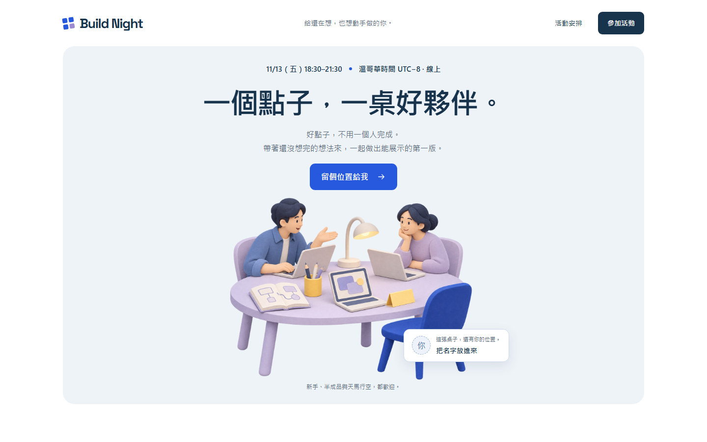

# Design Harness 0.2｜整合設計 Skills

[](LICENSE)



這是一套給 Claude 和 Codex 共用的設計、實作、驗證流程，已整合 Oil UI、Anthropic frontend-design、UI UX Pro Max 的原始 skills、參考檔與工具。AI 依需求選設計方向、實作，再根據實際截圖和測試結果修改。無需另外設定模型 API key。

## 授權

本專案原創的程式、文件與示範資產採 [MIT License](LICENSE)。`vendor/skills/`、本機字體、GSAP 等第三方內容保留各自的原授權，不由本專案重新授權；完整來源及條款位置見 [THIRD-PARTY-NOTICES.md](THIRD-PARTY-NOTICES.md)。

先讀 [START-HERE.md](START-HERE.md) 取得最短使用方式。新版示範採「共用桌面」風格，設計決定在 `design/DIRECTION.md`，實際使用哪份 skill／查詢在 `design/SKILL-USAGE.md`。

**Loop：需求 → 決定設計方向 → 實作 → 瀏覽器檢查 → 看截圖 → 修正 → 重測。**

## 第一次使用

需要 Node.js 20.11 以上與 npm（建議使用目前的 LTS）。在這個資料夾開啟終端機：

```sh
npm install
npm run setup
npx playwright install chromium
```

`setup` 會將主流程及三套原始 skills 裝到本專案 `.claude/skills/` 和 `.agents/skills/`，並準備本機動畫資產；不改全域設定。來源已隨工具包附上，不需另外下載這三套 skills。`skills.lock.json` 固定來源 commit 與檔案雜湊；`.harness/installed.json` 記錄由 setup 管理的版本。已管理且未被修改的舊版可以更新；偵測到本機改動就停止且不覆寫。修改主流程後執行 setup 同步。

```sh
npm run skills:check
npm run design:research -- "community maker workshop event"
```

第一條驗證 vendor 與兩邊安裝內容一致。第二條實際執行 UI UX Pro Max 本機設計資料庫，需要 Python 3；替換引號內的產品關鍵詞即可。查詢結果仍要由 AI 判斷適配，不會自動覆蓋你的設計。純文字的 Oil UI 與 frontend-design 不需要 Python。

開兩個終端機。第一個啟動示範頁：

```sh
npm run demo
```

第二個執行一次檢查：

```sh
npm run check
```

打開第一個終端機顯示的 localhost 網址即可看示範頁。每次檢查會印出報告目錄，內含 `report.html`、`report.json`、`summary.md`、截圖與 `review.md`。可執行 `npm run report`，從 `http://127.0.0.1:4174/` 進入對應報告。

**自動檢查通過只代表自動項目通過。** `review.md` 的視覺審查需要 Claude、Codex 或人開啟實際截圖完成；預設狀態為待審，不能當作已完成設計驗收。

## 直接貼給 Claude 或 Codex

```text
請使用本專案的 Design Harness，先讀 AGENTS.md、skill/SKILL.md、brief.md。
依流程讀取 vendor/skills 中 Oil UI、frontend-design、UI UX Pro Max 的原始指令。
用 Oil UI 決定與精修方向，用 UI UX Pro Max 查詢適合本產品的設計建議，
用 frontend-design 實作；把採用與捨棄的理由寫進 design/DIRECTION.md。
本次授權你自行選一個推薦方向並完成，無需為可逆的設計細節中途確認。
確認驗收條件後實作。執行 npm run check，
讀取最新 report.json，並真正開啟 desktop.png 和 mobile.png。
把具體視覺判斷與截圖位置寫進該次 review.md。
若失敗，根據證據修改再測；最多 3 輪，受阻時保留結果並說明原因。
只有自動檢查通過、視覺審查完成且需求達成時，才能宣告完成。
```

若工具沒有自動載入 skill，明確請它讀 `skill/SKILL.md`，流程仍可使用。這不是背景常駐的自主代理程式；每次由你在 Claude／Codex 開啟任務，AI 根據檢查結果迭代。

## 換成你們的作品

1. 編輯 `brief.md`：產品、受眾、主要任務、視覺方向、驗收條件。
2. 啟動你們自己的網站。
3. 編輯 `harness.config.json` 的 `url` 與 `flows`。`flows` 決定實際要點哪裡、填什麼、檢查什麼，必須對應產品。
4. 執行 `npm run check`。也能用 `npm run check -- --url http://127.0.0.1:3000` 覆蓋網址。
5. 請 AI 讀報告與截圖，修正後再執行。可用 `--config my-config.json` 指定另一份配置。

設定的 `requiredText` 會在初始畫面檢查；`flows` 按順序執行，支援 `fill`、`click`、`press`、`expectVisible`、`expectFocused`、`expectText`。每個動作以 CSS selector 指定元素。示範設定包括鍵盤切換欄位、無效信箱與有效提交三條流程。真實作品請換成登入、搜尋、建立項目等實際使用者任務。

## 明天的 loop test（約 20–30 分鐘）

1. **確認基準**：`npm run demo`，再 `npm run check`，記下報告目錄。看兩張截圖，確認手機及桌機都能完成報名。
2. **製造故障**：先執行 `npm run fault:on`，再執行 `npm run check -- --url "http://127.0.0.1:4173/?fault=overflow"`。預期手機的 `layout` 檢查失敗、結束碼為 1，並保留截圖。這個指令只改示範頁的一條寬度規則，網址必須帶 `fault=overflow` 才會生效。
3. **修正一輪**：把失敗報告交給 Claude，請它修復 `demo/styles.css` 的 `fault=overflow` 寬度規則；保持同一個故障網址與原始驗收設定，再次檢查。不得靠移除檢查或隱藏溢出蒙混過關。
4. **交接**：Claude 寫 `handoff.md`（使用 `handoff-template.md` 格式）；Codex 讀交接、重新執行相同檢查並檢視截圖。兩個 agent 若共用資料夾，請輪流修改。
5. **記錄**：測試是否發現故障、改了什麼、重測結果、是否需要人工介入。不用為了湊輪數繼續改已驗收的設計。

要直接還原示範故障，可執行 `npm run fault:off`。交付版預設已修復；重演請從 `fault:on` 開始。

`evidence/` 如有附帶結果，是製作這套工具時的實測紀錄；不是你們作品的驗收結果。

## 包含與邊界

- `skill/SKILL.md`：設計與修正流程的來源。
- `brief.md`：示範需求，可替換成正式題目。
- `harness.config.json`：桌機 1440×900／手機 390×844、關鍵流程與 timeout。
- `scripts/check.mjs`：Playwright 瀏覽器檢查＋axe-core 的 serious／critical 問題掃描；保留其他等級結果供參考。
- `demo/index.html`、`styles.css`、`app.js`：重新設計的前端報名頁，提交會把姓名加入工作桌的座位牌；沒有後端儲存。
- `demo/assets/illustration/shared-table.png`：本次生成並打包的專屬插畫；提示詞在 `design/HERO-ASSET.md`。
- `vendor/skills/`：三套上游原始 skills，包含 helpers、資料庫、參考與授權。
- `design/`：本次設計方向、skill 使用證據與評審紀錄。
- `handoff-template.md`：Claude／Codex 輪流接手時共用。

自動檢查目前涵蓋頁面載入、JavaScript 執行錯誤、必要文字、設定的互動、水平溢出與部分無障礙規則。它不能證明設計好看，也不是完整 WCAG 或後端驗證。報告保存初始畫面、每條 flow 完成後的 `*-flow-N.png`，以及全部互動後的截圖。

## 已整合的設計能力

整合日期：2026-11-05。完整授權與來源見 `THIRD-PARTY-NOTICES.md`。設計 skills 供宿主 AI 讀取並執行，不會在背景自動呼叫另一個模型。

- [Oil UI](https://github.com/oil-oil/oil-ui)：設計方向探索、並排比較、依實際截圖精修。
- [Anthropic frontend-design](https://github.com/anthropics/skills/tree/main/skills/frontend-design)：前端介面設計與實作指導。
- [UI UX Pro Max](https://github.com/nextlevelbuilder/ui-ux-pro-max-skill)：UI／UX 設計知識與建議。
- [Playwright](https://playwright.dev/docs/intro)、[axe-core](https://github.com/dequelabs/axe-core)：本工具的瀏覽器檢查與無障礙掃描依賴。

未整合：原始貼文中無法確認名稱的 Figma／手繪工具、付費 Oil UI Pro，以及 GitHub Agent Board。要採用 GitHub board 可另外接上，目前透過本機 handoff 交接。
